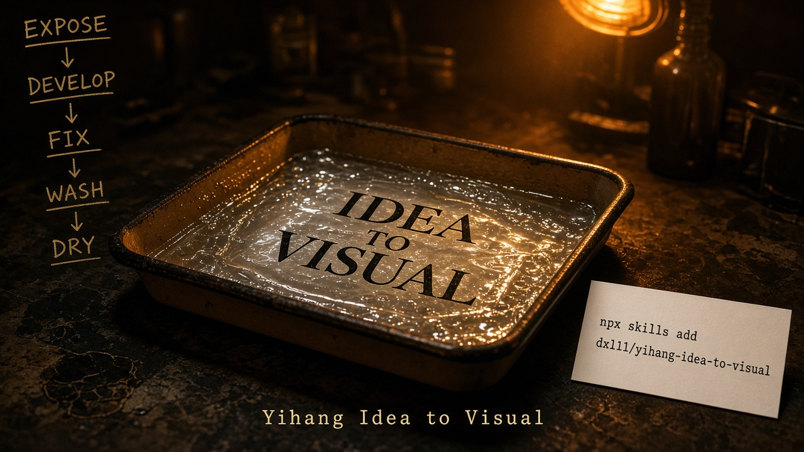

<p align="center">
  
</p>

<p align="center">
  <strong>Yihang Idea to Visual</strong><br/>
  <em>Ideas develop in the darkroom · one install · one creative pipeline</em>
</p>

<p align="center">
  English · <a href="README.md">简体中文</a> ·
  <a href="https://github.com/dxl11/yihang-idea-to-visual">GitHub</a> ·
  <a href="https://agentskills.io/specification">Agent Skills</a>
</p>

---

> **TIMER CARD — install now (Cursor project scope)**
>
> ```bash
> npx skills add dxl11/yihang-idea-to-visual --skill yihang-idea-to-visual -a cursor
> ```
>
> Node.js **22.20+** · Do **not** manually copy `SKILL.md`

Add `-g` for global install. Add `-y` for non-interactive CI. Full details in sections 4–5.

---

**Idea to Visual** takes a raw idea through Thought Reviewer, then staged polish, titles, cover, editorial pagination, and review—delivering ordered cover/body PNGs plus a ZIP ready for social publishing.

This repository ships **one** [Agent Skill](https://agentskills.io/specification) (`yihang-idea-to-visual`)—not an autonomous agent, multi-agent crew, MCP server, or web application. Thought Reviewer is an internal module of that skill, not a separate skill.

| Darkroom station | Creative stage | What you get |
|---|---|---|
| **EXPOSE** | Thought Reviewer | Claim understood, pressure-tested, skippable |
| **DEVELOP** | Article polish | Stance preserved, language clarified |
| **FIX** | Article lock | Exact text integrity—no silent rewrite |
| **WASH** | Title · Cover · Editorial | One platform, one canvas size |
| **DRY** | Review · Export | `00-cover.png` … + `final-export.zip` |

Core promise: **you stay in thinking and expression; the skill owns review, editing, design, typography, and delivery.**

---

## 1. Project name and introduction

**Yihang Idea to Visual** productizes the personal-IP content pipeline.

Canonical skill entry in this repository:

```text
.agents/skills/yihang-idea-to-visual/SKILL.md
```

## 2. Core positioning

Built for creators, researchers, and operators who publish branded carousels. Each project selects **one** platform and **one** canvas size, then exports an upload-ready image set.

## 3. Core features

- Thought Reviewer: idea critique, multi-turn dialogue, and optional skip
- Seven gated stages (thought review → article → title → cover → editorial → review → export)
- **Photo-to-Poster**: photo-driven art posters (one photo → one independent 3:4 PNG; top band uses source pixels)
- Locked-article integrity protection (no silent rewrite/summary/deletion)
- Platform profiles separated from skill instructions
- Thought library (method-card retrieval) plus visual reference library
- Three brand layers: long-term identity / lasting preferences / per-project style
- Pillow-based precise typography (split from generative imagery)
- Resumable private project state under `.idea-to-visual/projects/`
- Ordered ZIP delivery with automated validation

## 4. One-command install

Use the official [Vercel Skills CLI](https://github.com/vercel-labs/skills) via `npx skills`. **Do not** manually download or copy `SKILL.md`.

### Requirements

- Node.js **22.20** or later
- npm
- npx
- Cursor

Check your environment:

```bash
node -v
npm -v
```

### Cursor project install (recommended for teams)

```bash
npx skills add dxl11/yihang-idea-to-visual --skill yihang-idea-to-visual -a cursor
```

Installs into the current project only—ideal for collaboration.

### Cursor global install

```bash
npx skills add dxl11/yihang-idea-to-visual --skill yihang-idea-to-visual -a cursor -g
```

Installs into the user-global skills directory for use across projects.

### List installable skills in the repository

```bash
npx skills add dxl11/yihang-idea-to-visual --list
```

### Non-interactive install (CI / scripts)

```bash
npx skills add dxl11/yihang-idea-to-visual --skill yihang-idea-to-visual -a cursor -y
```

Local source discovery (maintainers):

```bash
npx skills add . --list
```

## 5. Cursor project vs global install

| Scope | Flag | Typical path |
|---|---|---|
| Project | omit `-g` | `./.agents/skills/yihang-idea-to-visual/` |
| Global | `-g` | `~/.cursor/skills/yihang-idea-to-visual/` |

A successful install includes `references/`, `scripts/`, `schemas/`, and `assets/` (visual reference library + brand samples). Relative paths remain valid after install.

Cursor project installs land in `.agents/skills/`—**do not** also hand-copy into `.cursor/skills/`.

### List installed skills

```bash
npx skills list
```

Filter to Cursor:

```bash
npx skills ls -a cursor
```

### Verify installation

1. Confirm `.agents/skills/yihang-idea-to-visual/SKILL.md` exists (project) or the matching global Cursor skills folder.  
2. Frontmatter `name` is `yihang-idea-to-visual`.  
3. `references/`, `scripts/`, `schemas/`, and `assets/` are present.  
4. In Cursor Agent chat, run `/yihang-idea-to-visual` or ask to turn notes into a carousel.

### After install: how to use

1. Open the project (or any project, if globally installed) in Cursor.  
2. Invoke `/yihang-idea-to-visual` or describe your creative request.  
3. Default start is Thought Reviewer; you may skip straight to polish. Then confirm each stage; the agent may run bundled Python helpers (Python 3.10+ and Pillow recommended).

Optional helper dependency:

```bash
python -m pip install "Pillow>=10"
```

## 6. Thought Reviewer

> **EXPOSE** — before polish, let the claim develop under safelight.

Many ideas are not yet clear enough to polish. Thought Reviewer understands the real claim first, then reviews it from multiple lenses—instead of immediately rewriting it into pretty prose.

### Six review lenses (internal to one skill)

1. Philosophical thinking  
2. Logical analysis  
3. Critical thinking  
4. Domain expertise (selected dynamically; not all domains every time)  
5. Creative thinking  
6. Ordinary-reader perspective  

### Eight qualitative dimensions (no fake precision scores)

Clarity, depth, logical rigor, evidential support, distinctiveness, counterargument stress-test, practical value, and expression potential.

Allowed labels: strong / worth strengthening / critical issue / worth exploring further / no outstanding issue found.

### Dialogue mechanism

- Prefer **one** key question per turn and wait for the author's judgment  
- Update the review from new answers instead of repeating the first conclusion  
- The author may keep the original stance; do not pressure toward an AI verdict  
- The author may end review anytime, or ask to enter article polish  

### Three modes

| Mode | Behavior |
|---|---|
| Standard (default) | Affirm valuable observations, then gaps and directions |
| Deep critique | When requested: prioritize argument, evidence, assumptions, strongest counter |
| Light | Core claim + one highlight + one question |

If the user explicitly declines thought review, continue directly to STEP 01.

### Thought library

Path: `.agents/skills/yihang-idea-to-visual/assets/thought-library/`

- Curated method cards across philosophy, logic, critique, business, economics, science, psychology, creativity, and systems thinking  
- Index with `scripts/build_thought_index.py` → `catalog.json`  
- Keep private expert materials under `private/` (gitignored) or in a local project path  
- Prefer extracting executable methods over uploading entire books  
- When citing: separate source wording from AI paraphrase; record author / title / section / page; never invent citations  
- **Do not** commit copyrighted full books to the public GitHub repository  

See [thought-library/README.md](.agents/skills/yihang-idea-to-visual/assets/thought-library/README.md) and [thought-reviewer.md](.agents/skills/yihang-idea-to-visual/references/thought-reviewer.md).

## 7. Full creative workflow

0. **STEP 00 — Thought Reviewer** — Understand the claim, multi-lens review, optional dialogue; skippable.  
1. **STEP 01 — Thought organization & polish** — Preserve stance and voice; lock on confirmation.  
2. **STEP 02 — Titles** — Offer five meaningfully different directions from the locked article.  
3. **STEP 03 — Cover** — Pick one platform; ask ≤3 decisive visual questions; show three structurally distinct cover previews.  
4. **STEP 04 — Editorial** — Semantic pagination; three body-style previews; batch render; add pages instead of cutting copy.  
5. **STEP 05 — Review** — Thumbnails; single/multi/global edits; copy changes require returning to STEP 01.  
6. **STEP 06 — QA & delivery** — Validate, then emit `00-cover.png`, `01-page.png`, … and `final-export.zip`.

Do not skip unconfirmed stages (Thought Reviewer may be skipped when the user explicitly asks). New chats must resume from project `state.json`.

## 8. Visual reference library

Path: `.agents/skills/yihang-idea-to-visual/assets/visual-reference-library/`

Built-in inspiration library maintained by the skill author. It is currently **empty**—only category folders and an empty `catalog.json` (`total_assets: 0`).

### Empty-library behavior

- Cover and editorial stages check `catalog.json`.  
- If empty → **skip retrieval** and keep the existing three cover / three editorial directions.  
- Never pretend assets exist before upload.

### Adding assets later

1. Place PNG / JPG / JPEG / WEBP / SVG files into category folders (`editorial/`, `cover-design/`, `carousel-layout/`, `color-palettes/`, …).  
2. Record a unique id plus source, author, and license.  
3. Run: `python .agents/skills/yihang-idea-to-visual/scripts/build_reference_index.py --full`  
4. Let a vision-capable agent fill layout / type / color / composition notes.  
5. Prefer `tags` for cross-category links instead of duplicating files.  

Keep private / unknown-license files under `private/` (gitignored)—internal analysis only; never ship into final public posts.

Index / contact sheets: `build_reference_index.py` · `create_contact_sheet.py`  

See [visual-reference-library/README.md](.agents/skills/yihang-idea-to-visual/assets/visual-reference-library/README.md).

## 8.5 Photo-to-Poster

Upload one or more photos and generate independent vertical posters using 12 art-style recipes (default **1080×1440 / 3:4**).

Hard rules: one photo → one poster; no collage/grid/merge; top band is real source pixels; bottom band is generated art; even with a shared style, each photo is a separate generation job.

Flow: inspect → recommend 3 styles → user picks (batch or per-photo) → generate & compose one-by-one → single regenerate without touching others → ZIP.

Assets: `assets/photo-to-poster/` · Guide: [photo-to-poster.md](.agents/skills/yihang-idea-to-visual/references/photo-to-poster.md)  
Scripts: `inspect_photo.py` · `compose_poster.py` · `validate_poster.py` · `export_posters.py`  
Local output: `.idea-to-visual/photo-to-poster-output/` (not committed)  
Image generation depends on host tools; disclose limits—never invent APIs.

## 9. Personal brand visual system

Three layers—never conflate them:

1. **Long-term brand identity** — stable recognition rules  
2. **Personal visual preferences** — lasting taste; update only with explicit consent  
3. **Project design profile** — per-work variation  

Sample: [brand-profile.sample.json](.agents/skills/yihang-idea-to-visual/assets/brand-kit/brand-profile.sample.json)  
Real logos/preferences go in `assets/brand-kit/private/` (not committed). Missing brand names must not invent a fake identity—continue with neutral design.

## 10. Usage examples

```text
User: Use Yihang Idea to Visual to turn these notes into a Xiaohongshu carousel.
AI: Enter STEP 00 Thought Reviewer, restate the claim, and ask one key question…
User: Skip review and polish directly.
AI: Enter STEP 01, polish the article → lock → ask whether to continue to titles…
```

Platform profiles: [profiles.json](.agents/skills/yihang-idea-to-visual/assets/platform-profiles/profiles.json)

```bash
python .agents/skills/yihang-idea-to-visual/scripts/build_thought_index.py --help
python .agents/skills/yihang-idea-to-visual/scripts/build_reference_index.py --help
python .agents/skills/yihang-idea-to-visual/scripts/render_pages.py --list-templates
python .agents/skills/yihang-idea-to-visual/scripts/validate_project.py --help
python .agents/skills/yihang-idea-to-visual/scripts/package_export.py --help
```

## 11. Update and uninstall

### Check for updates

```bash
npx skills check
```

### Update project skill

```bash
npx skills update yihang-idea-to-visual
```

### Update global skill

```bash
npx skills update yihang-idea-to-visual -g
```

### Uninstall project skill

```bash
npx skills remove yihang-idea-to-visual -a cursor
```

### Uninstall global skill

```bash
npx skills remove yihang-idea-to-visual -a cursor -g
```

> Commands follow the current Skills CLI. If the CLI changes, defer to [commands.md](https://github.com/vercel-labs/skills/blob/main/docs/commands.md).

### Install FAQ

**Q: `npx skills` complains about Node version?**  
Upgrade to Node.js 22.20+.

**Q: Cursor does not show the skill?**  
Confirm `-a cursor`, reload Cursor / reopen the project, and verify `.agents/skills/yihang-idea-to-visual/SKILL.md` (project scope).

**Q: Do I need to copy files by hand?**  
No. Always use `npx skills add ...`.

**Q: Will I get duplicate skill copies?**  
Cursor project installs use `.agents/skills/`. Do not also manually copy into `.cursor/skills/`.

**Q: Garbled Chinese in rendered PNGs?**  
Point `cjk_font_path` at an installed, licensed font. Missing fonts fail loudly instead of emitting mojibake.

## 12. Repository layout

```text
yihang-idea-to-visual/
├── README.md / README.en.md
├── docs/assets/readme-banner.png
├── LICENSE / ASSET-LICENSES.md / CONTRIBUTING.md / CHANGELOG.md
├── pyproject.toml / .gitignore
├── .github/workflows/validate.yml
├── .agents/skills/yihang-idea-to-visual/
│   ├── SKILL.md
│   ├── references/          # includes thought-reviewer.md
│   ├── scripts/             # includes build_thought_index.py
│   ├── schemas/
│   └── assets/
│       ├── thought-library/
│       └── visual-reference-library/
├── examples/
└── tests/
```

Keep private project data under `.idea-to-visual/projects/` (gitignored). Keep private thought notes under `assets/thought-library/private/`.

## 13. Contributing

See [CONTRIBUTING.md](CONTRIBUTING.md). Before opening a PR:

```bash
python -m pytest
```

Improvements to docs, platform profiles, scripts, and tests are welcome. Keep the skill id `yihang-idea-to-visual` and never commit private user content.

## 14. Copyright and privacy

- Code & docs: MIT ([LICENSE](LICENSE))  
- Images / fonts / logos: [ASSET-LICENSES.md](ASSET-LICENSES.md)  
- Banner: `docs/assets/readme-banner.png` is an original darkroom-theme illustration for this project (MIT)  
- Do not commit private articles, private visual references, private thought notes, private brand kits, API keys, tokens, or credentials  
- Do not bundle unauthorized third-party fonts, images, or copyrighted full books  
- Unknown-license references: internal analysis only  
- Thought-library citations must be traceable; never invent provenance  

### Current limitations

- No bundled cloud image API  
- Platform sizes are configurable defaults—verify against official sources when needed  
- Semantic reference analysis depends on host vision capability  
- CJK rendering quality depends on local fonts  
- Thought Reviewer depends on the host agent's reasoning and optional search; the library does not auto-ingest entire bookshelves  

---

<p align="center">
  <a href="https://github.com/dxl11/yihang-idea-to-visual">github.com/dxl11/yihang-idea-to-visual</a>
</p>
